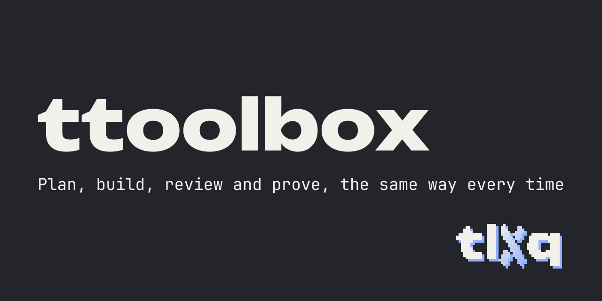
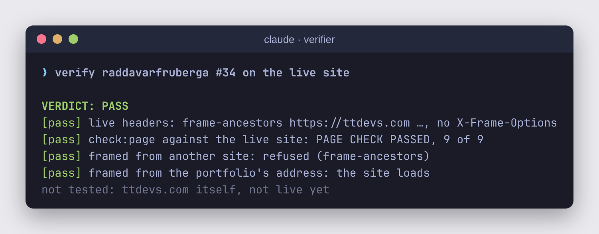
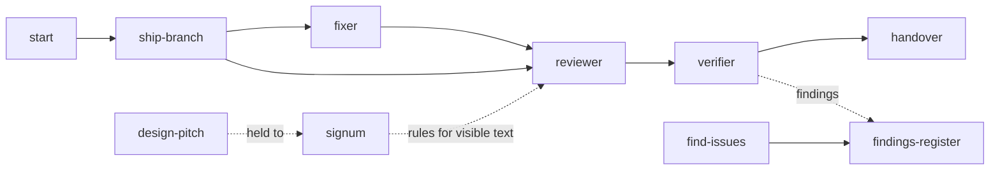

<p align="center"></p>

The Claude Code plugin I use every day to plan, build, review and prove my work, for developers who
want Claude to work the same careful way every time.

No live site: it's a plugin. Checks run on my own machine (`mise run check`, also the pre-push hook);
there is no CI.

<p align="center"></p>

<sub>A real verifier report from my own work (the findings in short), shown as terminal text.</sub>

## What's in it

One plugin, `workflow`: 9 skills and 4 agents.

| Skill | What it does |
|---|---|
| `start` | Before the first edit: goal, what "done" means and where, then names the skills and agents it will use. Asks once, with choices, only for what's missing. |
| `ship-branch` | One branch and one PR per change; done only when the checks are green. |
| `signum` | A rule book for every word and state people see: labels, status words, button verbs, errors, waiting, motion, tap size. Built from GitHub Primer, Apple's HIG and Material 3. |
| `design-pitch` | Walk the whole flow, ask taste questions as a picker, show a rendered pitch, and only then build. |
| `find-issues` | A read-only hunt for what's wrong, with evidence, grouped by cause, one long-term fix per group. |
| `findings-register` | Everything found along the way goes in one table in the plan; urgent items get fixed now. |
| `picture-check` | Before a PR that changes screens: pictures of every screen, before and after, side by side. |
| `commit-proposal` | A commit message from the staged diff, in the repo's own style. |
| `handover` | Ends a session: plan updated, nothing uncommitted, one `Next:` line, and how long you waited on Claude this week. |

| Agent | What it does |
|---|---|
| `verifier` | Proves a change works on the real thing (live URL, browser, phone, another machine) and answers PASS, FAIL or PARTIAL with evidence. Read-only. |
| `reviewer` | Reviews a diff before it becomes a PR: bugs, missing tests, repo rules, visible text against `signum`. Read-only. |
| `fixer` | Builds one change in its own git worktree, so several can run at once. |
| `researcher` | Reads a lot so the main session doesn't have to, and answers with `file:line` sources. |

A verifier report looks like this:

```
VERDICT: PASS
- [pass] live headers: frame-ancestors set, no X-Frame-Options
- [pass] page check against the live site: 9 of 9
- [pass] framed from another site: refused
- [not checked] the new domain itself: not live yet
```

## Why it exists

Claude is fast, but on its own it says "fixed" before anything is proven, forgets what it found an
hour ago, and writes "Something went wrong" on buttons. I kept giving the same instructions in every
session, so I wrote them down once as skills and agents. Now every session starts with what "done"
means, every finding has a home, every change gets a review, and nothing is called done until a
separate agent has checked it on the real thing.

This is the public part of my own toolbox. The other plugins depend on my private setup (my home
server, my CV) and stay private. The CLI that keeps my two PCs in step has its own repo: [dot](https://github.com/tlxq/dot).

## What was hard

Getting "done" to mean done. An agent asked to check its own work tends to confirm it, and narrow
"this works" probes once let a 13 000 px blank page reach production. The fix was to split the roles. The
`verifier` is its own agent with read-only tools, it is handed what "done" means instead of the
builder's opinion, it must name the real place each check ran (the live URL, the phone, the other
machine), and anything it couldn't run is reported as "not checked", never as passed. `start`
writes "done means" before the first edit, so there is something concrete to prove at the end.

## How it fits together



## Stack

Claude Code plugin (Markdown skills and agents) · Python 3 for the wait report · Bash · bats · mise ·
lefthook · gitleaks.

## Install

In Claude Code:

```
/plugin marketplace add tlxq/ttoolbox
/plugin install workflow@ttoolbox
```

Or from a terminal: `claude plugin marketplace add tlxq/ttoolbox`, then
`claude plugin install workflow@ttoolbox`.

Then open any repo and type `/workflow:start` with a task, or just describe the task: Claude picks a
skill from its description. Ask for "the verifier" when something should be proven. `handover`'s
wait report reads only your own local session logs and spends no usage.

The skills read your project's `CLAUDE.md` for its rules (who commits, what to ask first, where the
design tokens live), so they work best in a repo that has one.

## Work on it

```
git clone https://github.com/tlxq/ttoolbox && cd ttoolbox
mise install
lefthook install
mise run check
```

`mise run check` runs shellcheck, the bats tests (23) and `claude plugin validate`. The commit hooks
run gitleaks and `tools/public-guard`, which refuses AI attribution lines and any word from a private
word list (`NEVER_PUBLIC_FILE`, one word per line). Without a word list the guard prints a note and
skips only the word check; gitleaks and the AI attribution check still run and still refuse.

## Licence

[MIT](LICENSE) © 2026 Tom Larsson
